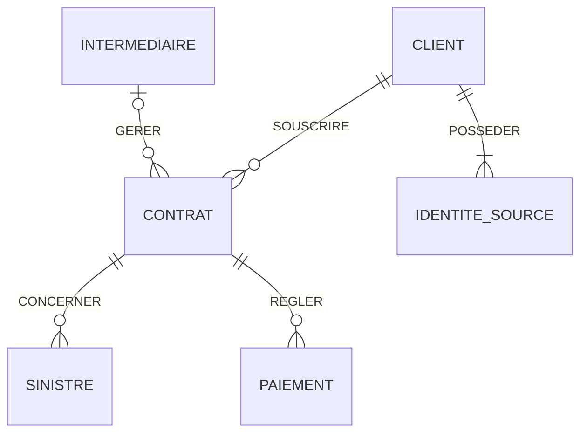

# MCD unifié — AbAssurance et AssurePlus

## Objectif
Unifier les données des deux compagnies d'assurance en conservant les identifiants historiques et la traçabilité des sources.

## Entités métier
- CLIENT : client unifié après rapprochement des identités.
- CONTRAT : contrat d'assurance.
- SINISTRE : déclaration de sinistre.
- PAIEMENT : règlement associé à un contrat.
- INTERMEDIAIRE : agence ou courtier, identifié par son type.

## Traçabilité
- IDENTITE_SOURCE : association entre un client unifié et ses identifiants historiques AbAssurance ou AssurePlus.
- Les identifiants historiques des contrats, sinistres, paiements et intermédiaires seront également conservés dans le modèle logique.

## Diagramme conceptuel (cardinalités proposées)

## Règles métier validées
1. Les clients identiques peuvent être fusionnés en un client unifié.
2. Les identifiants historiques des clients sont conservés.
3. Les agences et courtiers sont représentés par INTERMEDIAIRE.
4. Le type d'intermédiaire vaut AGENCE ou COURTIER.

## Correspondances des sources
| Oracle AbAssurance | SQL Server AssurePlus | Entité cible |
|---|---|---|
| AB_CLIENT | AP_USERS | CLIENT |
| AB_CONTRAT | AP_CONTRACTS | CONTRAT |
| AB_SINISTRE | AP_CLAIMS | SINISTRE |
| AB_PAIEMENT | AP_PAYMENTS | PAIEMENT |
| AB_AGENCE_ID | AP_BROKER_CODE | INTERMEDIAIRE |

## Points à confirmer
- Les clés primaires et étrangères exactes des bases sources.
- Les cardinalités métier et le caractère obligatoire des relations.
- Les critères de rapprochement et de fusion des clients.
- Les règles de normalisation des dates, primes, statuts et codes produits.
- La gestion des intermédiaires absents ou inconnus.
  
