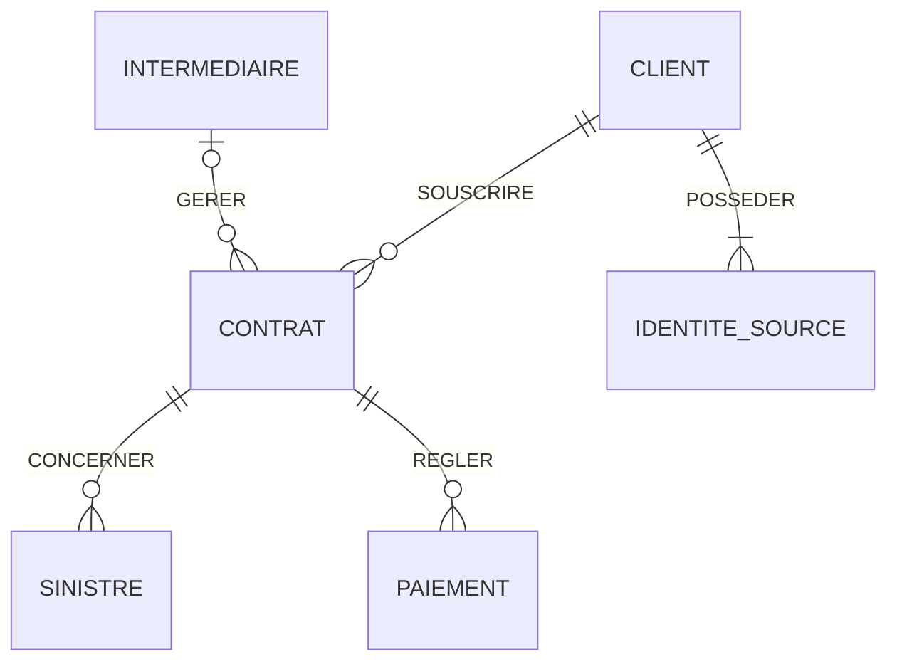

# MCD unifié — AbAssurance et AssurePlus

## Objectif
Unifier les données des deux compagnies d'assurance en conservant les identifiants historiques et la traçabilité des sources.

## Entités métier
- CLIENT : client unifié après rapprochement des identités.
- CONTRAT : contrat d'assurance.
- SINISTRE : déclaration de sinistre.
- PAIEMENT : règlement associé à un contrat.
- INTERMEDIAIRE : agence ou courtier, identifié par son type.

## Traçabilité
- IDENTITE_SOURCE : association entre un client unifié et ses identifiants historiques AbAssurance ou AssurePlus.
- Les identifiants historiques des contrats, sinistres, paiements et intermédiaires seront également conservés dans le modèle logique.

## Diagramme conceptuel (cardinalités proposées)

## Règles métier validées
1. Les clients identiques peuvent être fusionnés en un client unifié.
2. Les identifiants historiques des clients sont conservés.
3. Les agences et courtiers sont représentés par INTERMEDIAIRE.
4. Le type d'intermédiaire vaut AGENCE ou COURTIER.

## Correspondances des sources
| Oracle AbAssurance | SQL Server AssurePlus | Entité cible |
|---|---|---|
| AB_CLIENT | AP_USERS | CLIENT |
| AB_CONTRAT | AP_CONTRACTS | CONTRAT |
| AB_SINISTRE | AP_CLAIMS | SINISTRE |
| AB_PAIEMENT | AP_PAYMENTS | PAIEMENT |
| AB_AGENCE_ID | AP_BROKER_CODE | INTERMEDIAIRE |

## Points à confirmer
- Les clés primaires et étrangères exactes des bases sources.
- Les cardinalités métier et le caractère obligatoire des relations.
- Les critères de rapprochement et de fusion des clients.
- Les règles de normalisation des dates, primes, statuts et codes produits.
- La gestion des intermédiaires absents ou inconnus.
  # MCD unifié — Attributs et associations

## 1. Entité CLIENT

**Identifiant :** `client_id`

| Attribut | Description |
|---|---|
| client_id | Identifiant unifié |
| nom | Nom du client |
| prenom | Prénom du client |
| nom_complet | Nom complet si non décomposable |
| date_naissance | Date de naissance |
| email | Adresse électronique |
| telephone | Numéro de téléphone |
| adresse | Adresse postale |
| code_postal | Code postal |
| numero_fiscal | Identifiant fiscal, lorsqu'il existe |
| date_creation | Date de création du client |
| statut_client | Statut harmonisé |
| score_fidelite | Score de fidélité, lorsqu'il existe |

**Règle :** plusieurs enregistrements historiques peuvent correspondre à un seul client unifié. Les identifiants historiques restent conservés dans IDENTITE_SOURCE.

## 2. Entité CONTRAT

**Identifiant :** `contrat_id`

| Attribut | Description |
|---|---|
| contrat_id | Identifiant unifié |
| reference_contrat | Référence historique du contrat |
| type_assurance | Type d'assurance ou produit harmonisé |
| date_debut | Date de prise d'effet |
| date_fin | Date de fin |
| prime_annuelle | Prime exprimée sur une base annuelle |
| statut_contrat | Statut harmonisé |

**Règle :** la prime mensuelle d'AssurePlus doit être convertie en prime annuelle selon une règle validée, par exemple une multiplication par 12 si les montants sont strictement mensuels.

## 3. Entité SINISTRE

**Identifiant :** `sinistre_id`

| Attribut | Description |
|---|---|
| sinistre_id | Identifiant unifié |
| reference_sinistre | Référence historique |
| date_sinistre | Date de l'événement |
| montant_estime | Montant estimé |
| statut_sinistre | Statut harmonisé |
| description | Description ou commentaire |
| score_fraude | Score de fraude, lorsqu'il existe |

## 4. Entité PAIEMENT

**Identifiant :** `paiement_id`

| Attribut | Description |
|---|---|
| paiement_id | Identifiant unifié |
| reference_paiement | Référence historique |
| date_paiement | Date et heure du paiement, si disponibles |
| montant | Montant réglé |
| mode_paiement | Mode ou canal de paiement |
| statut_transaction | Statut de transaction, lorsqu'il existe |

## 5. Entité INTERMEDIAIRE

**Identifiant :** `intermediaire_id`

| Attribut | Description |
|---|---|
| intermediaire_id | Identifiant unifié |
| type_intermediaire | AGENCE ou COURTIER |
| reference_intermediaire | Identifiant ou code historique |

**Règle validée :** les agences AbAssurance et les courtiers AssurePlus appartiennent à une même entité conceptuelle, différenciés par `type_intermediaire`.

## 6. Entité IDENTITE_SOURCE

**Identifiant :** `identite_source_id`

| Attribut | Description |
|---|---|
| identite_source_id | Identifiant de correspondance |
| systeme_source | ABASSURANCE ou ASSUREPLUS |
| identifiant_historique | Identifiant du client dans sa base d'origine |

**Règle :** chaque identité source est rattachée à un client unifié. Un client unifié peut avoir plusieurs identités sources.

## 7. Associations conceptuelles

| Association | Entité A | Cardinalité A | Entité B | Cardinalité B |
|---|---|---|---|---|
| SOUSCRIRE | CLIENT | 0,N | CONTRAT | 1,1 |
| CONCERNER | CONTRAT | 0,N | SINISTRE | 1,1 |
| REGLER | CONTRAT | 0,N | PAIEMENT | 1,1 |
| GERER | INTERMEDIAIRE | 0,N | CONTRAT | 0,1 |
| POSSEDER | CLIENT | 1,N | IDENTITE_SOURCE | 1,1 |

Les cardinalités sont proposées à partir des schémas fournis et restent à valider avec les règles métier.

## 8. Règles de qualité et de traçabilité

- Conserver les identifiants historiques lors des fusions de clients.
- Éviter toute fusion automatique sans critères de rapprochement suffisamment fiables.
- Normaliser les dates, montants, statuts et codes produits.
- Conserver les informations spécifiques à chaque source.
- Prévoir une traçabilité des opérations de transformation.
- Ne jamais écraser les données des bases historiques.

## 9. Points à valider

- Règles exactes de rapprochement des clients.
- Correspondance des codes produits et types d'assurance.
- Règles de conversion des primes mensuelles.
- Cardinalités métier des associations.
- Gestion des paiements et contrats sans intermédiaire identifié.
- Définition des clés et contraintes réelles dans les bases sources.
