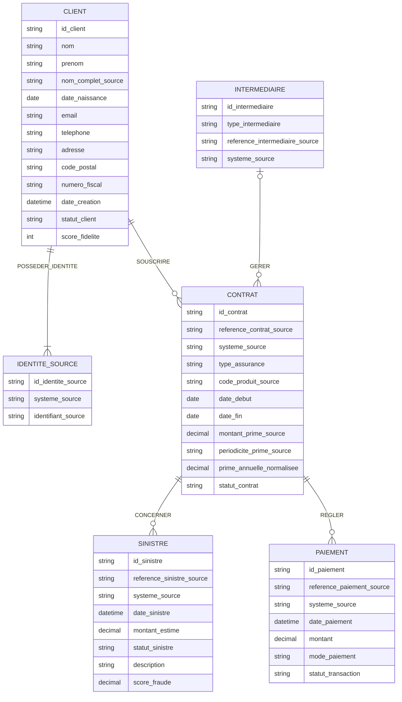

# MCD unifié — AbAssurance et AssurePlus

## 1. Objectif

Concevoir un modèle conceptuel de données (MCD) commun à deux compagnies d'assurance :

- AbAssurance : base Oracle.
- AssurePlus : base SQL Server.

Le modèle doit permettre :
- l'unification des informations clients ;
- la conservation des identifiants historiques ;
- la détection des clients potentiellement identiques ;
- la gestion des contrats, sinistres et paiements ;
- la représentation commune des agences et courtiers ;
- la traçabilité des données d'origine.

Le MCD décrit les règles métier. Les clés étrangères et les types SQL détaillés relèvent du futur modèle logique de données (MLD).

## 2. Entités et attributs

### CLIENT

Représente une personne cliente, indépendamment de son système d'origine.

| Attribut | Description |
|---|---|
| id_client | Identifiant interne du client unifié |
| nom | Nom du client |
| prenom | Prénom du client |
| nom_complet_source | Nom complet d'origine, si disponible |
| date_naissance | Date de naissance |
| email | Adresse électronique normalisée |
| telephone | Numéro de téléphone |
| adresse | Adresse postale |
| code_postal | Code postal |
| numero_fiscal | Numéro fiscal, disponible dans AbAssurance |
| date_creation | Date de création du dossier |
| statut_client | Statut harmonisé du client |
| score_fidelite | Score de fidélité, disponible dans AssurePlus |

La séparation de AP_FULL_NAME en nom et prénom peut être ambiguë. La valeur originale doit rester traçable.

### IDENTITE_SOURCE

Conserve les identifiants historiques des clients.

| Attribut | Description |
|---|---|
| id_identite_source | Identifiant interne de l'identité source |
| systeme_source | ABASSURANCE ou ASSUREPLUS |
| identifiant_source | Identifiant historique dans la base d'origine |

Un client unifié peut être associé à plusieurs identités sources.

Le couple (systeme_source, identifiant_source) doit identifier une seule identité source.

### CONTRAT

Représente un contrat d'assurance souscrit par un client.

| Attribut | Description |
|---|---|
| id_contrat | Identifiant interne du contrat |
| reference_contrat_source | Référence historique du contrat |
| systeme_source | Système d'origine |
| type_assurance | Type d'assurance ou produit harmonisé |
| code_produit_source | Code produit d'origine, si disponible |
| date_debut | Date de début |
| date_fin | Date de fin |
| montant_prime_source | Montant de prime d'origine |
| periodicite_prime_source | ANNUELLE ou MENSUELLE |
| prime_annuelle_normalisee | Prime annualisée selon une règle validée |
| statut_contrat | Statut harmonisé du contrat |

La référence historique est interprétée avec son système source pour éviter les collisions.

### SINISTRE

Représente une déclaration de sinistre liée à un contrat.

| Attribut | Description |
|---|---|
| id_sinistre | Identifiant interne |
| reference_sinistre_source | Identifiant historique du sinistre |
| systeme_source | Système d'origine |
| date_sinistre | Date et heure du sinistre |
| montant_estime | Montant estimé |
| statut_sinistre | Statut harmonisé |
| description | Description ou commentaire |
| score_fraude | Score de fraude, disponible dans AssurePlus |

### PAIEMENT

Représente un paiement associé à un contrat.

| Attribut | Description |
|---|---|
| id_paiement | Identifiant interne |
| reference_paiement_source | Identifiant historique du paiement |
| systeme_source | Système d'origine |
| date_paiement | Date et heure du paiement |
| montant | Montant payé |
| mode_paiement | Mode ou canal de paiement |
| statut_transaction | Statut de transaction, disponible dans AssurePlus |

### INTERMEDIAIRE

Représente une agence ou un courtier intervenant dans la gestion d'un contrat.

| Attribut | Description |
|---|---|
| id_intermediaire | Identifiant interne |
| type_intermediaire | AGENCE ou COURTIER |
| reference_intermediaire_source | Identifiant historique |
| systeme_source | Système d'origine |

Aucun nom, adresse ou autre détail d'intermédiaire n'est supposé sans source correspondante.

## 3. Associations et cardinalités proposées

| Association | Entité A | Entité B | Règle métier proposée |
|---|---|---|---|
| SOUSCRIRE | CLIENT (0,N) | CONTRAT (1,1) | Un contrat appartient à un client |
| POSSEDER_IDENTITE | CLIENT (1,N) | IDENTITE_SOURCE (1,1) | Une identité source correspond à un client unifié |
| CONCERNER | CONTRAT (0,N) | SINISTRE (1,1) | Un sinistre concerne un contrat |
| REGLER | CONTRAT (0,N) | PAIEMENT (1,1) | Un paiement est associé à un contrat |
| GERER | INTERMEDIAIRE (0,N) | CONTRAT (0,1) | Un contrat peut avoir un intermédiaire identifié |

Ces cardinalités sont des hypothèses de conception à confirmer avec les règles métier.

## 4. Diagramme conceptuel

Visualisation indicative du MCD avec Mermaid :

Les types affichés dans Mermaid sont indicatifs. Ils ne constituent pas encore le schéma physique.

## 5. Correspondance entre les systèmes sources

| Oracle AbAssurance | SQL Server AssurePlus | Entité cible |
|---|---|---|
| AB_CLIENT | AP_USERS | CLIENT |
| AB_CLIENT_ID | AP_USER_ID | IDENTITE_SOURCE |
| AB_CONTRAT | AP_CONTRACTS | CONTRAT |
| AB_POLICY_NUMBER | AP_CONTRACT_REF | Référence historique du contrat |
| AB_SINISTRE | AP_CLAIMS | SINISTRE |
| AB_CLAIM_ID | AP_SINISTRE_NUM | Référence historique du sinistre |
| AB_PAIEMENT | AP_PAYMENTS | PAIEMENT |
| AB_PAYMENT_ID | AP_PAYMENT_REF | Référence historique du paiement |
| AB_AGENCE_ID | AP_BROKER_CODE | INTERMEDIAIRE |

Les identifiants historiques sont conservés avec le système source, sans supposer qu'ils sont uniques entre compagnies.

## 6. Règles de normalisation

### Identité client

- Uniformiser les espaces et la casse pour les comparaisons.
- Normaliser les adresses électroniques.
- Convertir les dates vers un format cohérent.
- Conserver les valeurs historiques nécessaires à la traçabilité.
- Ne pas fusionner automatiquement deux clients sur la seule égalité de leur nom.

### Rapprochement des clients

Le pipeline Python produit :
- une liste `clients` de clients normalisés ;
- une liste `correspondances_candidates` de rapprochements possibles.

Une correspondance candidate ne constitue pas une fusion validée.

L'affectation d'un même id_client à plusieurs identités sources doit reposer sur une décision de rapprochement validée.

### Contrats et primes

AbAssurance fournit une prime annuelle, tandis qu'AssurePlus fournit une prime mensuelle.

La conversion indicative :

prime_annuelle_normalisee = prime_mensuelle × 12

ne doit être appliquée qu'après validation de la règle métier et de la périodicité réelle.

### Dates

Les dates stockées sous forme de texte dans AssurePlus doivent être converties et contrôlées, notamment AP_BIRTH_DATE et AP_INCIDENT_DATE.

### Statuts

Les statuts des clients, contrats, sinistres et transactions doivent faire l'objet de tables de correspondance métier dans le futur MLD ou les traitements de transformation.

## 7. Règles de traçabilité

- Conserver le système d'origine des enregistrements.
- Préserver les identifiants historiques.
- Éviter toute collision d'identifiants entre les deux compagnies.
- Distinguer les correspondances candidates des fusions validées.
- Prévoir la traçabilité des transformations et décisions de rapprochement.

## 8. Points restant à valider

1. Clés primaires et étrangères exactes des bases sources.
2. Cardinalités définitives et caractère obligatoire des associations.
3. Critères de rapprochement et procédure de validation des fusions.
4. Gestion des clients sans données complètes.
5. Normalisation des primes, dates, statuts et codes produits.
6. Gestion des contrats sans intermédiaire identifié.
7. Conservation des valeurs sources et historique des modifications.
8. Règles de gestion des paiements et sinistres particuliers.

## 9. Périmètre de cette version

Ce document constitue la version consolidée du MCD de référence.

Le pipeline Python actuel couvre principalement la normalisation des clients, la détection des correspondances candidates et l'export JSON.

La prise en charge opérationnelle des contrats, sinistres, paiements et intermédiaires reste à développer.

Les prochaines étapes sont :
- validation métier du MCD ;
- construction du modèle logique de données (MLD) ;
- définition du dictionnaire de données ;
- préparation des traitements d'intégration Big Data.
