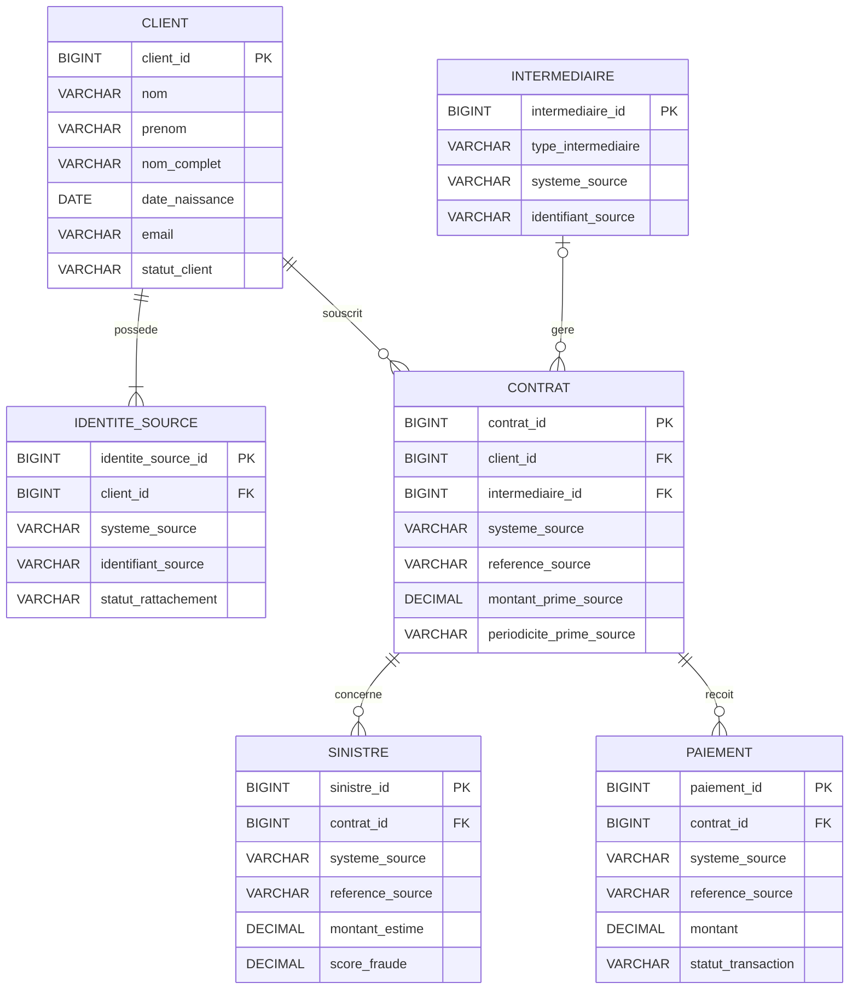

# MLD unifié — AbAssurance et AssurePlus

## 1. Objectif

Définir le Modèle Logique de Données (MLD) de la plateforme
d'unification des données d'assurance provenant de :

- AbAssurance : Oracle
- AssurePlus : SQL Server

Le modèle doit permettre :
- l'unification des clients ;
- la conservation des identifiants historiques ;
- la gestion des contrats, sinistres et paiements ;
- la représentation des agences et courtiers ;
- la traçabilité des données sources ;
- la préparation des traitements Big Data et analytiques.

Ce document décrit un modèle cible proposé, et non une
description des contraintes physiques déjà vérifiées dans
les bases sources.

## 2. Conventions

- PK : clé primaire
- FK : clé étrangère
- UK : contrainte d'unicité
- NULL : valeur facultative
- NOT NULL : valeur obligatoire

Les identifiants techniques cibles sont générés par la
plateforme et ne remplacent pas les identifiants sources.

Les montants sont exprimés en DECIMAL, jamais en FLOAT.

Les types indiqués sont logiques et devront être adaptés
au moteur de stockage cible.

## 3. Tables du MLD

### 3.1 CLIENT

Représente une identité client unifiée.

| Attribut | Type logique | Contrainte | Description |
|---|---|---|---|
| client_id | BIGINT | PK | Identifiant unifié |
| nom | VARCHAR(200) | NULL | Nom normalisé |
| prenom | VARCHAR(200) | NULL | Prénom normalisé |
| nom_complet | VARCHAR(400) | NULL | Nom complet d'origine ou reconstitué |
| date_naissance | DATE | NULL | Date de naissance |
| email | VARCHAR(150) | NULL | Adresse électronique normalisée |
| telephone | VARCHAR(25) | NULL | Téléphone normalisé |
| adresse | VARCHAR(255) | NULL | Adresse postale |
| code_postal | VARCHAR(10) | NULL | Code postal |
| numero_fiscal | VARCHAR(30) | NULL | Numéro fiscal, si disponible |
| statut_client | VARCHAR(20) | NULL | Statut harmonisé |
| score_fidelite | INTEGER | NULL | Score disponible dans AssurePlus |
| date_creation_source | TIMESTAMP | NULL | Date de création métier issue d'une source |
| date_integration | TIMESTAMP | NOT NULL | Date d'intégration dans la plateforme |

Remarques :
- AP_FULL_NAME ne permet pas toujours de distinguer
  automatiquement nom et prénom.
- Le numéro fiscal est présent dans AbAssurance uniquement.
- Le score de fidélité provient d'AssurePlus.
- Les conflits entre valeurs sources doivent être arbitrés
  selon des règles de survivance à définir.
- Une identité unifiée ne doit pas être créée par fusion
  automatique sur la seule égalité des noms.

### 3.2 IDENTITE_SOURCE

Conserve les identifiants historiques des clients.

| Attribut | Type logique | Contrainte | Description |
|---|---|---|---|
| identite_source_id | BIGINT | PK | Identifiant technique |
| client_id | BIGINT | FK, NOT NULL | Référence CLIENT |
| systeme_source | VARCHAR(30) | NOT NULL | ABASSURANCE ou ASSUREPLUS |
| identifiant_source | VARCHAR(100) | NOT NULL | Identifiant client historique |
| date_rattachement | TIMESTAMP | NOT NULL | Date de rattachement |
| methode_rattachement | VARCHAR(30) | NULL | Origine de la décision |
| statut_rattachement | VARCHAR(30) | NOT NULL | Statut du rapprochement |

Contraintes proposées :
- FK(client_id) vers CLIENT(client_id)
- UK(systeme_source, identifiant_source)

Règles :
- Un client unifié possède au moins une identité source.
- Une identité source appartient à un seul client unifié.
- Plusieurs identités sources peuvent être rattachées à
  un même client après validation du rapprochement.
- Une correspondance candidate n'entraîne pas
  automatiquement une fusion.

### 3.3 INTERMEDIAIRE

Représente une agence ou un courtier.

| Attribut | Type logique | Contrainte | Description |
|---|---|---|---|
| intermediaire_id | BIGINT | PK | Identifiant technique |
| type_intermediaire | VARCHAR(20) | NOT NULL | AGENCE ou COURTIER |
| systeme_source | VARCHAR(30) | NOT NULL | Système d'origine |
| identifiant_source | VARCHAR(100) | NOT NULL | Code agence ou courtier |
| date_integration | TIMESTAMP | NOT NULL | Date d'intégration |

Contraintes proposées :
- UK(systeme_source, type_intermediaire, identifiant_source)
- CHECK(type_intermediaire IN ('AGENCE', 'COURTIER'))

Correspondances :
- AB_CONTRAT.AB_AGENCE_ID : AGENCE
- AP_CONTRACTS.AP_BROKER_CODE : COURTIER

Aucun nom, adresse ou autre détail d'intermédiaire
n'est supposé disponible dans les sources actuelles.

### 3.4 CONTRAT

Représente un contrat d'assurance.

| Attribut | Type logique | Contrainte | Description |
|---|---|---|---|
| contrat_id | BIGINT | PK | Identifiant technique |
| client_id | BIGINT | FK, NOT NULL | Client titulaire |
| intermediaire_id | BIGINT | FK, NULL | Agence ou courtier |
| systeme_source | VARCHAR(30) | NOT NULL | Système d'origine |
| reference_source | VARCHAR(100) | NOT NULL | Référence historique |
| type_assurance | VARCHAR(50) | NULL | Type ou produit d'assurance |
| date_debut | DATE | NULL | Début du contrat |
| date_fin | DATE | NULL | Fin du contrat |
| montant_prime_source | DECIMAL(12,2) | NULL | Prime telle que fournie |
| periodicite_prime_source | VARCHAR(20) | NULL | ANNUELLE ou MENSUELLE |
| prime_annuelle_normalisee | DECIMAL(12,2) | NULL | Prime annualisée, si règle validée |
| statut_contrat | VARCHAR(30) | NULL | Statut harmonisé |
| date_integration | TIMESTAMP | NOT NULL | Date d'intégration |

Contraintes proposées :
- FK(client_id) vers CLIENT(client_id)
- FK(intermediaire_id) vers INTERMEDIAIRE(intermediaire_id)
- UK(systeme_source, reference_source)

Correspondances :
- AB_POLICY_NUMBER : référence du contrat AbAssurance
- AP_CONTRACT_REF : référence du contrat AssurePlus
- AB_PRIME_ANNUELLE : prime annuelle
- AP_MONTHLY_PREMIUM : prime mensuelle

La conversion d'une prime mensuelle en prime annuelle
(par exemple, multiplication par 12) nécessite la
validation préalable de la règle métier.

Les valeurs d'origine et leur périodicité sont conservées.

### 3.5 SINISTRE

Représente une déclaration de sinistre.

| Attribut | Type logique | Contrainte | Description |
|---|---|---|---|
| sinistre_id | BIGINT | PK | Identifiant technique |
| contrat_id | BIGINT | FK, NOT NULL | Contrat concerné |
| systeme_source | VARCHAR(30) | NOT NULL | Système d'origine |
| reference_source | VARCHAR(100) | NOT NULL | Identifiant historique |
| date_sinistre | TIMESTAMP | NULL | Date de l'incident |
| montant_estime | DECIMAL(12,2) | NULL | Montant estimé |
| statut_sinistre | VARCHAR(30) | NULL | Statut harmonisé |
| description | TEXT | NULL | Description ou commentaire |
| score_fraude | DECIMAL(5,2) | NULL | Score issu d'AssurePlus |
| date_integration | TIMESTAMP | NOT NULL | Date d'intégration |

Contraintes proposées :
- FK(contrat_id) vers CONTRAT(contrat_id)
- UK(systeme_source, reference_source)

Correspondances :
- AB_CLAIM_ID / AP_SINISTRE_NUM
- AB_DATE_SINISTRE / AP_INCIDENT_DATE
- AB_MONTANT_ESTIME / AP_ESTIMATED_AMOUNT
- AB_STATUT_SINISTRE / AP_CLAIM_STATUS
- AB_DESCRIPTION / AP_CLAIM_COMMENT

Le score de fraude n'est disponible que dans AssurePlus.

AP_INCIDENT_DATE doit être analysée et convertie
depuis son format texte avant intégration.

### 3.6 PAIEMENT

Représente un paiement associé à un contrat.

| Attribut | Type logique | Contrainte | Description |
|---|---|---|---|
| paiement_id | BIGINT | PK | Identifiant technique |
| contrat_id | BIGINT | FK, NOT NULL | Contrat concerné |
| systeme_source | VARCHAR(30) | NOT NULL | Système d'origine |
| reference_source | VARCHAR(100) | NOT NULL | Identifiant historique |
| date_paiement | TIMESTAMP | NULL | Date du paiement |
| montant | DECIMAL(12,2) | NULL | Montant payé |
| mode_paiement | VARCHAR(30) | NULL | Mode ou canal |
| statut_transaction | VARCHAR(20) | NULL | Statut disponible dans AssurePlus |
| date_integration | TIMESTAMP | NOT NULL | Date d'intégration |

Contraintes proposées :
- FK(contrat_id) vers CONTRAT(contrat_id)
- UK(systeme_source, reference_source)

Correspondances :
- AB_PAYMENT_ID / AP_PAYMENT_REF
- AB_DATE_PAIEMENT / AP_PAYMENT_DATETIME
- AB_MONTANT / AP_AMOUNT_PAID
- AB_MODE_PAIEMENT / AP_PAYMENT_CHANNEL

AP_PAYMENT_REF est un UNIQUEIDENTIFIER dans SQL Server :
sa valeur historique est conservée sous forme textuelle
dans le modèle cible.

## 4. Relations et cardinalités proposées

| Relation | Cardinalité | Interprétation |
|---|---|---|
| CLIENT - IDENTITE_SOURCE | 1 à N | Un client possède une ou plusieurs identités sources |
| CLIENT - CONTRAT | 0 à N | Un client peut avoir plusieurs contrats |
| INTERMEDIAIRE - CONTRAT | 0 à N | Un intermédiaire peut gérer plusieurs contrats |
| CONTRAT - SINISTRE | 0 à N | Un contrat peut avoir plusieurs sinistres |
| CONTRAT - PAIEMENT | 0 à N | Un contrat peut avoir plusieurs paiements |

Chaque contrat référence un seul client unifié.

Chaque sinistre et chaque paiement référence un seul contrat.

Un contrat peut ne pas avoir d'intermédiaire identifié.

Ces cardinalités restent à confirmer avec les règles métier
et les contraintes des bases sources.

## 5. Diagramme relationnel

## 6. Traçabilité et rapprochement

Les identifiants historiques des clients sont stockés
dans IDENTITE_SOURCE.

Pour les contrats, sinistres, paiements et intermédiaires,
la provenance est conservée au moyen de :
- systeme_source ;
- reference_source ou identifiant_source.

La détection de correspondances candidates entre clients
est distincte de leur fusion effective.

Le pipeline Python existant permet de normaliser les
enregistrements et d'identifier des correspondances
candidates sans procéder automatiquement à la fusion.

La stratégie de validation des correspondances et
d'attribution définitive des client_id reste à définir.

## 7. Règles de qualité des données

### 7.1 Clients

- Nettoyer les espaces superflus.
- Normaliser les adresses électroniques.
- Convertir les dates au format cible.
- Préserver les identifiants historiques.
- Ne pas déduire une identité commune du seul nom.

### 7.2 Contrats

- Vérifier la présence du client associé.
- Contrôler la cohérence des dates de début et de fin.
- Conserver la périodicité originale des primes.
- Harmoniser les types d'assurance et les statuts.

### 7.3 Sinistres

- Vérifier le rattachement au contrat.
- Convertir les dates textuelles d'AssurePlus.
- Contrôler les montants estimés.
- Conserver le score de fraude lorsqu'il existe.

### 7.4 Paiements

- Vérifier le rattachement au contrat.
- Conserver les références historiques.
- Harmoniser les modes et canaux de paiement.
- Préserver le statut de transaction lorsqu'il existe.

## 8. Points restant à valider

1. Les PK, FK et contraintes réelles des bases sources.
2. Les règles de fusion et de survivance des attributs clients.
3. Les cardinalités et obligations métier.
4. Les référentiels de statuts et de produits.
5. La conversion des primes mensuelles et annuelles.
6. Les règles de traitement des dates et valeurs invalides.
7. Le traitement des intermédiaires inconnus.
8. La politique de gestion des données personnelles.
9. Le choix du moteur de stockage cible.
10. Les stratégies d'historisation et de mise à jour.

## 9. Prochaines étapes

1. Valider ce MLD.
2. Définir le MPD adapté au stockage cible.
3. Implémenter les transformations et les contrôles.
4. Étendre le pipeline aux contrats, sinistres et paiements.
5. Intégrer les traitements Big Data.
6. Préparer les jeux de données analytiques et ML.
